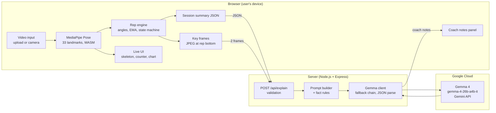

# HiperMove: know which reps actually counted

**Hacktoberfest Hack Day 2026 · KodeKurrent S2 × Open Science Labs (OSL) · Track: Best Use of Gemma 4**

Film a set of squats, push-ups or bicep curls on your phone. HiperMove tracks your joints in the browser, counts every rep, separates **full reps from partial reps**, and then **Gemma 4** reads the measurements and two rep snapshots to tell you, in plain English, what to fix next set. Your video never leaves your device.


### Team Binary Brains
- **Arjav Jain** (team lead)
- **Nagorao Dinkar Kute**
- **Ayush Mishra**
- **Nimit Jain**

---

## The problem

People who train at home or without a coach can't see their own form. Rep-counter apps give you a number, but they can't tell you **which reps didn't count or why**. Half reps and shallow depth slip by unnoticed, which stalls progress and builds habits that can lead to injury. A raw joint angle like "knee 128°" means nothing to most people.

In our own squat test clip, **2 of 3 reps were partial**, which is easy to miss without tracking.

## What HiperMove does

1. **Track:** MediaPipe Pose finds 33 body joints in every frame, inside the browser.
2. **Count:** our rep engine measures the working joint angle and classifies each rep as full or partial, along with depth, tempo and torso lean.
3. **Explain:** Gemma 4 reads the session summary plus the bottom frame of two reps and writes short coach notes: what happened, why, and one thing to change.

**Features**
- Squat, push-up and bicep curl
- Upload a clip or use the live camera
- Live skeleton overlay with the measured joint and its angle
- Full vs partial rep detection, per-rep metrics and an angle-over-time chart
- Coach notes from Gemma 4, written in plain language
- Privacy by design: only a small JSON summary and 2 JPEG frames are sent to the server

## How we use Gemma 4

Gemma 4 does the part that math can't: turning numbers and images into advice a beginner can act on.

- **Model:** `gemma-4-26b-a4b-it` through the Gemini API (configurable with `GEMMA_MODEL`).
- **Multimodal input:** the session summary JSON **and** up to 3 key frames (the bottom of a rep, with the skeleton drawn on), so Gemma can comment on what is visible as well as what was measured.
- **Grounded by design:** reps are counted by deterministic, unit-tested code. Gemma only explains them, so it **cannot invent a rep count**.
- **Fact rules in the prompt:** the server adds exercise-specific rules before every call. For example, a torso lean under 45° in a squat is normal, so don't tell the user to lift their chest; partial reps must always be mentioned with a fix.
- **Fast and reliable:** `thinkingLevel: minimal` and a 1024-token cap cut response time from about 45 s to 8–15 s. If the reply comes back empty, the server retries with a larger budget, then without images.

Real Gemma 4 output on our squat test clip, word for word:

> "Two reps were partial because they did not reach the 100-degree depth target. To turn those partial reps into full reps, focus on sitting a bit lower."

## Architecture



- **Inference:** pose estimation runs on the device (MediaPipe WASM, GPU with CPU fallback). LLM inference runs in the Gemini API.
- **No database, no accounts, no model training, no retrieval or agents.** The server is stateless and stores nothing.
- **External services:** Gemini API (Gemma 4), and jsDelivr / Google Storage for the MediaPipe library and model.

### Rep-counting engine (`shared/repCounter.js`)

```
TOP ──► DOWN ──► BOTTOM ──► back to TOP = +1 full rep
          │
          └── turns back before the target angle = partial rep
```

- Joint angle (hip–knee–ankle or shoulder–elbow–wrist), corrected for the video's aspect ratio
- EMA smoothing and hysteresis thresholds, so jitter doesn't create fake reps
- **Side lock:** tracks one side of the body and only switches if the other side is clearly more visible
- **Visibility gate:** torso lean is measured only when the hip is clearly in frame

| Exercise | Joint measured | Counts when below | Finishes when above | Partial if dips below |
|---|---|---|---|---|
| Squat | knee | 100° | 160° | 140° |
| Push-up | elbow | 95° | 155° | 135° |
| Bicep curl | elbow | 55° | 145° | 110° |

Thresholds live in `shared/repCounter.js` → `EXERCISES`.

## Results

All results below were **measured** on our own recorded clips and test suite during the hackathon.

| What | Result |
|---|---|
| Squat clip (1 full + 2 partial) | **3/3** reps classified correctly |
| Push-up clip (3 full + 1 partial) | **4/4** reps classified correctly |
| Rep-engine unit tests | **5/5** passing |
| Gemma 4 response time | **about 45 s → 8–15 s** after tuning |
| Video uploaded to any server | **0 seconds** |

**Baseline:** a basic rep counter would report 3 squats and 4 push-ups and stop there. It can't flag the 3 partial reps or explain why they fell short.

**Not yet measured:** accuracy across many different users, bodies and camera setups.

## Challenges we solved

| Problem | What we did |
|---|---|
| Tracked arm flipped mid-rep and created fake partial reps | Side lock: switch limbs only when the other is clearly more visible |
| Hips out of frame produced a fake 55–67° torso lean in curl clips | Measure lean only when the hip is clearly visible |
| Gemma took about 45 s and sometimes returned empty replies | Minimal thinking, a 1024-token cap and a retry chain |
| Gemma gave generic or wrong tips (e.g. "lift your chest" at a normal 16° lean) | Server-side exercise fact rules added to every prompt |

## Run it locally

**Requirements:** Node.js 18.17 or newer, and a free Gemini API key from [Google AI Studio](https://aistudio.google.com/apikey).

```bash
git clone https://github.com/Nimit0808/Hipermove
cd Hipermove
npm install
cp .env.example .env        # then put your GEMINI_API_KEY in .env
npm start                   # open http://localhost:3000
```

On Windows you can double-click `setup.bat` instead (or run `setup.sh` on macOS/Linux). It installs everything, runs the tests, asks for your key and starts the server.

```bash
npm test                    # rep-engine unit tests
npm run check               # checks that your key can reach Gemma 4
```

The camera needs `localhost` or HTTPS. Uploading a clip works anywhere.

**Docker:**

```bash
docker build -t hipermove .
docker run -p 3000:3000 --env-file .env hipermove
```

### Recording tips
- Film from the **side**, with your whole body in frame and the phone at roughly hip height.
- Use good light, a plain background and fitted clothing.
- Start standing tall, do 3–10 reps, and finish standing.

## Project layout

```
server.js                 Express: static files, /api/explain (Gemma 4), /api/health
shared/repCounter.js      angle maths, smoothing, side lock, rep state machine, session summary
public/index.html         UI
public/app.js             MediaPipe setup, overlay drawing, chart, key frames, Gemma call
public/styles.css         light and dark theme
test/repCounter.test.js   unit tests: angles, full/partial reps, noise, visibility, side lock, lean
scripts/check-gemma.js    smoke test for the Gemma endpoint
setup.bat / setup.sh      one-click setup
Dockerfile                container build
```

## Limitations

- A single 2D camera means angles shift with camera height and tilt. A side view is assumed.
- Thresholds are general, not personalised to each user's mobility.
- One person per frame. Loose clothing, occlusion and low light reduce tracking quality.
- Our test set is small and self-recorded.
- HiperMove gives estimates and coaching tips. It is **not a medical device** and does not diagnose anything.

## What's next

- **Now:** 3 exercises with Gemma 4 coach notes
- **Next:** lunges, shoulder press and more exercises
- **Then:** personal thresholds and workout history
- **Later:** Gemma running on the device for fully offline use

## Built during the hackathon

Everything in this repo was written during the Hack Day: the rep-counting engine, per-rep metrics, side lock and visibility gate, key-frame capture, the Gemma 4 prompt with fact rules and the multimodal pipeline, the UI, tests and setup scripts.

## Credits

- **MediaPipe Pose Landmarker** (`@mediapipe/tasks-vision` 0.10.35, `pose_landmarker_full`), Google, Apache 2.0
- **Gemma 4** (`gemma-4-26b-a4b-it`) via the Gemini API, Google, subject to the Gemma Terms of Use
- **Express** and **dotenv** (MIT)

License: MIT (as declared in `package.json`).
